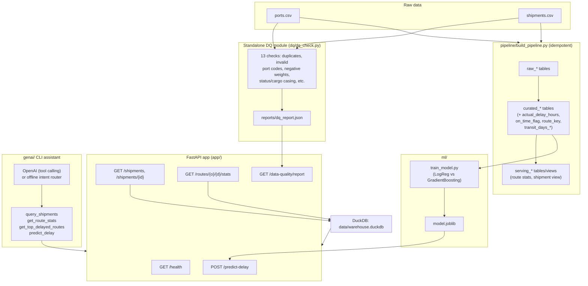

# Supply Chain Intelligence Mini-Platform

A thin, end-to-end slice of a supply-chain intelligence platform: a REST API over
container shipment data, a standalone data-quality module, a raw → curated →
serving pipeline on DuckDB, a booking-time delay-risk model, and a tool-calling
GenAI assistant.

Built as a take-home assignment. Scope was deliberately balanced across
engineering, data, and ML/GenAI rather than polished in any one area.

---

## Getting started

Requirements: Docker + Docker Compose (tested with Docker 29 / Colima on macOS).

```bash
git clone <this-repo>
cd supply-chain-platform
docker compose up --build
```

This single command:
1. Runs `data-init` once: standalone DQ checks → raw→curated→serving pipeline →
   model training. All three write their output to the bind-mounted `data/`,
   `reports/`, and `ml/` folders, so you can inspect them without a shell into
   the container.
2. Starts the `api` service on **http://localhost:8000** once `data-init` exits
   successfully (`depends_on: condition: service_completed_successfully`).

Verify it's up:

```bash
curl localhost:8000/health
# {"status":"ok","version":"0.1.0","database_available":true}
```

Try the rest:

```bash
curl "localhost:8000/shipments?limit=3"
curl localhost:8000/shipments/SHP-00010
curl localhost:8000/routes/NLRTM/PKKAR/stats
curl "localhost:8000/routes/top-delayed?limit=5"
curl localhost:8000/data-quality/report
curl -X POST localhost:8000/predict-delay -H "Content-Type: application/json" \
  -d '{"shipment_id":"SHP-00010"}'
```

GenAI assistant (CLI, optional compose profile so it doesn't start by default):

```bash
docker compose --profile genai run --rm genai "What is the delay risk for shipment SHP-00010?"
```

Without `OPENAI_API_KEY` set, the assistant runs in a deterministic **offline
demo mode** that still exercises the real tool-calling architecture against
the live API (see "Tech choices" below). Set `OPENAI_API_KEY` (copy
`.env.example` → `.env`) to use a real LLM.

### Running without Docker

```bash
pip install -r requirements.txt
make build   # dq -> pipeline -> train, in order
make run     # uvicorn on :8000
make test    # 34 unit + integration tests
```

### End-to-end time check

Clone → `docker compose up --build` → healthy API: **under 3 minutes** on a
standard laptop with a warm Docker image cache (most of that is `pip install`
inside the image build; subsequent builds are seconds thanks to layer
caching). Verified locally during development.

---

## Architecture diagram



A hand-drawn equivalent would show the same four boxes left-to-right: **CSV
files → DQ check (side door, no dependency on the pipeline) → pipeline →
DuckDB (raw/curated/serving) → FastAPI → GenAI assistant on top calling the
API's own endpoints as tools.**

---

## Tech choices

| Area | Choice | Why |
|---|---|---|
| **API framework** | FastAPI | Async-friendly, automatic OpenAPI docs, Pydantic validation for free, minimal boilerplate for a thin slice. |
| **Data store** | DuckDB (single file, `data/warehouse.duckdb`) | Embedded, zero infra to run, excellent columnar/analytical SQL performance for ~5K-30K rows, reads pandas DataFrames natively (register + `CREATE TABLE AS`). Perfect fit for "ingest CSVs, run analytical queries" at this scale. |
| **ML framework** | scikit-learn (LogisticRegression + GradientBoostingClassifier) | Mature, fast to train/evaluate on tabular data this size, no GPU/infra needed, both models trivially wrapped in one `Pipeline` with a `ColumnTransformer` for consistent preprocessing at inference time. |
| **LLM** | OpenAI `gpt-4o-mini` via tool calling, with an offline deterministic fallback | Cheapest OpenAI model with reliable tool-calling; rough cost ≈ **$0.0005–0.002 per query** (a few hundred input tokens + a couple of tool round-trips at $0.15/$0.60 per 1M in/out tokens). Offline fallback keeps the assistant testable/demoable with no API key and no network. |
| **Test framework** | pytest + FastAPI `TestClient` | `TestClient` runs the real ASGI app in-process (real routing, middleware, exception handlers) without needing a live socket, so "integration" tests stay fast while still exercising real HTTP semantics. |
| **CI platform** | GitHub Actions (implemented, `.github/workflows/ci.yml` — see "CI/CD" section) | Free for public/private repos at this scale, native Docker build action, no separate infra. |
| **Linting** | ruff | Single fast tool covering flake8 + isort + pyflakes; low friction. |

**What I'd change at 100× the data volume (≈500K shipments, 2.5M events):**
DuckDB still handles hundreds of millions of rows comfortably for analytical
queries, so it is *not* the first thing I'd replace. What breaks first is the
**single-file, single-writer** model: concurrent ingestion + API reads on one
`.duckdb` file gets awkward. At that scale I'd move to **Postgres (or DuckDB
reading partitioned Parquet from object storage)** for the serving layer so
the API can scale reads horizontally, keep DuckDB (or Spark/Polars) as the
curated-layer *batch compute engine* reading/writing Parquet, and introduce a
real orchestrator (Airflow/Dagster) instead of a single Python script once
there are multiple dependent pipelines.

**Other notable choices and one-line rationale:**
- `joblib` to persist the sklearn pipeline (preprocessing + model together) — avoids train/serve skew.
- Pydantic schemas for every API response — structured errors and typed docs come for free.
- Structured JSON logging via a custom `logging.Formatter` rather than a logging SaaS — zero extra infra, greppable, easy to pipe into any log aggregator later.
- `httpx` for the GenAI assistant's tool calls — the assistant calls the *same* HTTP API a human would, so there's one source of truth for business logic instead of two (API queries vs. assistant queries hitting DuckDB directly).

**What I explicitly decided not to do, and why:**
- **port_events.csv** was referenced in the assignment brief as a ~25,000-row streaming event log but was **not present in the supplied data folder** (only `ports.csv` and `shipments.csv` were). I did not fabricate a synthetic version of it — inventing 25K rows of events risked more harm (false signal) than leaving it out, and the three required parts (API, DQ/pipeline, ML/GenAI) are fully satisfiable from the two files provided. This is called out here explicitly as an assumption rather than silently working around it.
- No authentication/authorization on the API — out of scope for a take-home thin slice; called out in the runbook as a production gap.
- No message queue / streaming ingestion — the data is batch CSVs, not an actual stream, so a batch pipeline is the right-sized solution today.
- No Kubernetes/Terraform — explicitly out of scope per the assignment brief.
- No front-end — CLI/HTTP only, as the brief allows.
- Did not attempt heavy hyperparameter tuning on the ML model — with an honestly near-random AUC (see ML section), tuning would be polishing noise; the right next step is feature/label investigation, not grid search.

---

## Data quality summary

Full machine-readable report: `reports/dq_report.json`, also served live at
`GET /data-quality/report`. Generated by the **standalone** script
`dq/dq_check.py`, which only reads the raw CSVs — it has no dependency on the
pipeline or the database, so quality can be verified before anything is
ingested.

```bash
python dq/dq_check.py --input data/raw --output reports/dq_report.json
```

| # | Check | Severity | Rows | % of total | Decision |
|---|---|---|---|---|---|
| 1 | Invalid port code (`ZZZZZ`/`XXTST`/`UNKNW` sentinels) | critical | 95 | 1.89% | Quarantine — excluded from curated layer, can't compute route stats without a valid route. |
| 2 | `actual_arrival` missing but status is DELIVERED/DELAYED (contradiction) | critical | 82 | 1.63% | Flag (`arrival_status_conflict`) — kept in curated data, excluded from on-time aggregates until resolved. |
| 3 | Duplicate `shipment_id` with conflicting values | critical | 56 | 1.11% | Quarantine both conflicting rows — can't safely pick a winner. |
| 4 | Negative `weight_tons` (physically impossible) | critical | 36 | 0.72% | Fix — take absolute value, flag row as `weight_corrected`. |
| 5 | Zero `container_count` (not a valid booking) | critical | 23 | 0.46% | Quarantine. |
| 6 | Inconsistent `cargo_type` casing/whitespace (`FURNITURE`, `electronics`, ` Chemicals`, ...) | warning | 261 | 5.19% | Fix — normalise to one canonical Title Case set. |
| 7 | Inconsistent `status` labels (`COMPLETED`/`Complete`/`delivered` vs. canonical) | warning | 92 | 1.83% | Fix — map synonyms to `DELIVERED`/`DELAYED`/`CANCELLED`. |
| 8 | Missing `status` | warning | 54 | 1.07% | Fix — infer DELIVERED/DELAYED from actual vs. planned arrival where possible (0 of these had usable dates in practice), else `UNKNOWN`. |
| 9 | `container_count` outlier (> 500, e.g. up to 996) | warning | 17 | 0.34% | Flag (`container_count_outlier`) — kept, excluded from scale-sensitive features until reviewed. |
| 10 | Exact full-row duplicates | warning | 8 | 0.16% | Drop, keep first occurrence. |
| 11 | Missing `country` in `ports.csv` | warning | 1 | 4.00% of ports | Fix — fill with `"Unknown"` (reference data is small enough to eventually fix by hand). |
| 12 | Missing `weight_tons` | info | 73 | 1.45% | Fix — impute with per-cargo-type median, fallback to overall median. |
| 13 | Missing `cargo_type` | info | 15 | 0.30% | Fix — impute as `"Unknown"`. |

Net effect on the curated layer: **5,028 raw shipment rows → 4,864 curated
rows** (164 quarantined across checks #1, #3, #5 — some rows trip more than
one check). Every decision and its row count is reproducible by re-running
`dq/dq_check.py` and `pipeline/build_pipeline.py` independently.

### Data model (curated / serving layer)

- `raw_ports`, `raw_shipments` — byte-for-byte copies of the CSVs, for audit/debugging only.
- `curated_ports` — `raw_ports` with `country` imputed, deduplicated by `port_code`.
- `curated_shipments` — cleaned, deduplicated, with derived fields:
  - `actual_delay_hours` = `actual_arrival − planned_arrival` (null-safe)
  - `on_time_flag` = `actual_delay_hours ≤ 24`
  - `route_key` = `origin_port + " → " + destination_port`
  - `transit_days_planned` / `transit_days_actual`
  - plus DQ audit flags: `weight_corrected`, `weight_imputed`, `status_inferred`, `container_count_outlier`, `arrival_status_conflict`
- `serving_route_stats` — one row per `(origin_port, destination_port)` with shipment count, avg delay, on-time rate, avg transit days. Backs `/routes/{o}/{d}/stats`.
- `serving_shipments` (view) — the API-facing projection of `curated_shipments`. Backs `/shipments` and `/shipments/{id}`.

Keys: `shipment_id` (shipments PK), `port_code` (ports PK), `route_key`
(derived, groups shipments for route stats). Relationship: `shipments.origin_port`
/ `destination_port` → `ports.port_code` (many-to-one, enforced only logically
— DuckDB here is not enforcing FK constraints, which is an acceptable
trade-off at this scale and is exactly how the invalid-port-code DQ issue was
caught in the first place).

**Idempotency:** every pipeline stage uses `CREATE OR REPLACE TABLE`, and the
cleaning logic is purely a function of the raw CSVs (no incremental/append
state). Running `pipeline/build_pipeline.py` any number of times produces
byte-identical row counts — verified manually by running it twice in a row
during development (4,864 curated rows both times).

---

## Production support runbook

**Verifying health after a deployment**
1. `curl <host>/health` → expect `{"status":"ok", "database_available":true}`. `degraded` means the warehouse file is missing/unmounted — check the `data-init` job ran.
2. Smoke-test one read path and one compute path: `GET /shipments?limit=1` and `POST /predict-delay` with a known shipment id. Both should return 200 within ~100ms locally.
3. Check the Docker healthcheck status: `docker compose ps` should show `(healthy)` within ~25s of container start.
4. Tail logs for a spike in `status_code >= 500` in the structured JSON access logs.

**Most likely failure modes**
1. **Model artefact missing/stale** (`FileNotFoundError` from `app/model_runtime.py`) — `/predict-delay` returns 500. Diagnose: check `ml/model.joblib` exists and `data-init` completed; fix by re-running `make train` or `docker compose up data-init`.
2. **DuckDB file locked/corrupted** — happens if the writer (pipeline) and reader (API) touch the same file concurrently in an unexpected way. Diagnose via the exception logged under `unhandled_exception` in the API logs; fix by re-running the pipeline to regenerate `data/warehouse.duckdb` (it's a rebuildable artefact, not a source of truth — the CSVs are).
3. **DQ report 503** — `/data-quality/report` returns 503 if `reports/dq_report.json` isn't present (e.g. a volume wasn't mounted). Diagnose by checking the `data-init` container logs; fix by re-running `dq/dq_check.py`.

**Rolling back a bad release**
With a single Docker image per release: re-point `docker compose` (or your
orchestrator) at the previous image tag and restart — since all state lives
in bind-mounted `data/`/`reports/`/`ml/`, the API container itself is
stateless and trivially swappable. Because the pipeline/model/DQ outputs are
deterministic functions of the raw CSVs, a rollback never requires a data
migration — only "run the previous code version against the same raw data."

**What I'd add next for real production**
- **Monitoring/alerting**: request-rate, error-rate, and p50/p95/p99 latency dashboards (e.g. Prometheus + Grafana, or a hosted APM); alert on 5xx rate and health-check failures.
- **Model monitoring**: track prediction distribution drift and periodically recompute AUC/F1 against newly-closed shipments (see ML section below) with alerting if AUC drops below a floor.
- **Secrets management**: `OPENAI_API_KEY` currently comes from a plain env var — would move to a secrets manager (AWS Secrets Manager / Vault) in production.
- **Structured log shipping**: ship the JSON logs to a central store (CloudWatch/Datadog/ELK) instead of stdout-only.
- **A real database with concurrent-write support** once ingestion becomes continuous rather than batch (see "Scaling to production").

---

## CI/CD

**Status: implemented (Option A).** See `.github/workflows/ci.yml`.

[](https://github.com/<owner>/<repo>/actions/workflows/ci.yml)

> Replace `<owner>/<repo>` once this repo is pushed to GitHub — the badge
> only renders against a real remote. This was built and validated on an
> office machine with no outbound push access, so the workflow's stages
> (lint, unit tests, `make build`, integration tests, `docker build` + smoke
> test) were each run locally exactly as GitHub Actions would run them, but
> the workflow has not yet executed inside Actions itself.

**Pipeline stages** (`.github/workflows/ci.yml`, two jobs: `test` then `docker-build`)
1. **Install** — `pip install -r requirements.txt` (cached by hash of `requirements.txt`).
2. **Lint** — `ruff check .`. Fails the build on any lint error.
3. **Unit tests** — `pytest tests/unit -v`. No infrastructure required, runs in seconds.
4. **Build artefacts** — `make build` (DQ report → pipeline → model training) so integration tests have real data to run against.
5. **Integration tests** — `pytest tests/integration -v` against the artefacts built in step 4.
6. **Build Docker image** — `docker build -t supply-chain-api:$GIT_SHA .` and (optionally) push to a registry on `main`.

**Quality gates**
- Before merge: lint + unit tests + integration tests must all pass on the PR branch; at least one review approval.
- Before deploy: the Docker image must build successfully and pass a post-build smoke test (`docker run ... && curl /health`).

**Tooling and why**: GitHub Actions — no separate CI infra to run/maintain,
native integration with PR status checks, free minutes cover this project's
scale comfortably.

**Deployment strategy**: merge to `main` → CI builds and tags the image with
the commit SHA → pushed to a container registry → a deploy step (e.g. `docker
compose pull && docker compose up -d` on a single host, or a rolling update on
ECS/Cloud Run for something more production-like) pulls the new tag. Given the
service is stateless (all state is in the bind-mounted data layer), a rolling
restart is safe with no draining logic beyond the existing Docker healthcheck.

**Rollback mechanism**: redeploy the previous image tag (every image is
tagged with its commit SHA, so "previous" is always addressable). No data
migration is ever required for rollback because the pipeline/model outputs
are pure functions of the versioned raw CSVs, not of mutable application
state.

---

## ML: delay prediction

**Target**: will this shipment arrive more than 24 hours late? (binary, derived from `actual_delay_hours > 24`).

**Features used (all available at booking time)** — see `ml/features.py`:
`container_count`, `weight_tons`, `transit_days_planned` (planned arrival −
planned departure), `origin_congestion_score` / `destination_congestion_score`
(from `ports.csv`), `booking_lead_days` (planned departure − booking date),
`planned_departure_dow`, `planned_departure_month`, `origin_port`,
`destination_port`, `cargo_type`.

**Explicitly excluded**: `actual_departure`, `actual_arrival`, `status`, and
anything derived from them (`actual_delay_hours`, `on_time_flag`) — these are
only known after the fact and including any of them would leak the label.
`tests/unit/test_features.py::test_no_leakage_columns` asserts this
mechanically.

**Only rows with a known, trustworthy outcome are used for training** —
cancelled/unknown-status shipments have no ground truth and are dropped
before the train/test split (4,524 of 4,864 curated rows qualify).

**Models compared** (`ml/train_model.py`, 80/20 stratified split, random_state=42):

| Model | Accuracy | Precision | Recall | F1 | AUC |
|---|---|---|---|---|---|
| Logistic Regression | 0.518 | 0.422 | 0.523 | 0.467 | **0.514** |
| Gradient Boosting (selected) | 0.579 | 0.422 | 0.118 | 0.184 | **0.517** |

**Honest take**: both models are close to random (AUC ≈ 0.51–0.52). Gradient
Boosting is selected because it edges out Logistic Regression on AUC, but its
recall (0.12) is poor — it's mostly predicting the majority class. I'm
reporting this plainly rather than hiding it: on this dataset, the
booking-time features available (congestion score, transit time, cargo type,
weight, lead time) carry very little signal about whether a shipment will be
>24h late, which suggests either (a) the delay in this synthetic dataset is
close to pure noise, or (b) the real driver of delay lives in information we
don't have at booking time (weather, carrier-specific reliability, customs
risk, etc.) and isn't present in `ports.csv`/`shipments.csv`. A well-evaluated,
honestly-reported near-random model is far more useful than a model that looks
good because of a leaky feature or an un-stratified split.

**Monitoring in production**: track (1) prediction score distribution over
time (population stability index) to catch input drift, (2) realised AUC/F1
on a rolling window of shipments that have since closed out (compare
predicted risk vs. actual >24h-late outcome), (3) feature null-rates at
inference time (a spike suggests an upstream DQ regression). **Retrain
triggers**: realised AUC drops below ~0.55 for two consecutive weekly windows,
or feature distributions drift beyond a set PSI threshold, or a scheduled
quarterly retrain regardless, to absorb seasonal effects.

**Model artefact**: trained and saved to `ml/model.joblib` (committed, not
regenerated at request time). `app/model_runtime.py` loads it once at process
startup; `/predict-delay` calls `.predict_proba()` on the already-fitted
pipeline.

---

## GenAI assistant

CLI at `genai/assistant.py`. LLM: **OpenAI `gpt-4o-mini`** via tool calling
(`OPENAI_API_KEY` env var); falls back to a small deterministic offline intent
router when no key is set, so the tool-calling architecture is fully testable
without network access (rough cost when online: **$0.0005–$0.002 per
query** — a few hundred prompt tokens plus 1-2 tool round-trips at
gpt-4o-mini's $0.15/$0.60 per-million-token pricing).

Verified against the real OpenAI API (not just the offline fallback) with all
three example questions from the brief, plus the off-domain and
unknown-shipment-id guardrail cases — see `genai/logs/assistant_log.jsonl`
for the full prompt/tool-call/response trace of each run.

**Tools** (`genai/tools.py`, OpenAI function-calling schema):
- `query_shipments(origin_port?, destination_port?, status?, limit?)` — reads the curated data product via the running API's `/shipments`.
- `get_route_stats(origin, destination)` — calls `/routes/{origin}/{destination}/stats`.
- `get_top_delayed_routes(limit?, order?)` — calls `/routes/top-delayed`; ranks routes by average delay across all available history (no time-window field exists in the data, so "this quarter" in the example question is answered over all history — documented assumption). Added after noticing the real LLM correctly *refused to guess* on "which routes have had the highest average delay" when no tool existed for it, rather than hallucinating a ranking — exactly the guardrail behaviour we want, but it meant the tool was missing, not just the guardrail working.
- `predict_delay(shipment_id)` — calls `/predict-delay`.

**Guardrails implemented**
1. **Off-domain refusal**: a keyword gate plus an explicit system-prompt
   instruction refuses non-supply-chain questions (e.g. "tell me a joke")
   before/instead of calling the LLM.
2. **Tool-call cap**: at most 5 tool invocations per question
   (`MAX_TOOL_CALLS` in `assistant.py`), to bound cost and stop any
   runaway tool-call loop.
3. **Citation requirement**: the system prompt requires the model to name
   which tool produced each factual claim (e.g. "(via get_route_stats)");
   the offline fallback always does this too.

**Logging**: every call — online or offline — appends one JSON line to
`genai/logs/assistant_log.jsonl` with the question, every tool call (name +
arguments + result), and the final output. Treated as a production
observability requirement, not an afterthought.

```bash
python genai/assistant.py "Which routes have had the highest average delay this quarter?"
python genai/assistant.py "What is the on-time rate for shipments from Shanghai to Rotterdam?"
python genai/assistant.py "What is the delay risk for shipment SHP-00421?"
```

---

## If I had more time

- **Investigate the ML signal gap properly**: the near-random AUC deserves a
  deeper look — bucket delay by cargo type/route/season and check for
  non-linear interactions a plain GBM with default hyperparameters might
  miss, and sanity-check the synthetic data generator's delay logic if
  available.
- **Add the missing `port_events.csv`-shaped data**: if a real streaming event
  log existed, I'd fold arrival/departure/inspection events into features
  (e.g. recent port congestion events, inspection flags) — likely a much
  richer signal than static `avg_congestion_score`.
- **Property-based tests** for the DQ checks and pipeline cleaning (Hypothesis)
  to cover more edge cases than the hand-written examples.
- **A `/data-quality/report` history** (store each run with a timestamp) so
  drift in data quality over time is visible, not just the latest snapshot.
- **Confirm CI actually goes green on GitHub** — the workflow was authored
  and every stage validated locally (lint, tests, `make build`,
  `docker build` + smoke test) on a machine with no outbound push access;
  the first real push should be watched closely in case anything differs
  in the Actions runner environment (e.g. available memory for the
  `docker-build` job).
- **Pagination cursors** instead of offset/limit on `/shipments` for large
  pages, and response caching on `/routes/*/stats` (it's a relatively static
  aggregate).
- **Auth** (API keys at minimum) — currently fully open, fine for a local
  thin slice, not fine for anything real.

---

## Scaling to production

At **millions of shipments, 24/7 reliability**, several of today's choices
would need to change:

**What breaks first**: the single-file DuckDB warehouse. DuckDB is a
single-writer engine; one process doing `CREATE OR REPLACE TABLE` while the
API reads from the same file is fine at today's batch-once-a-day scale, but
it does not support concurrent writers, which a 24/7 ingestion pipeline
needs. The *second* thing that breaks is the ingestion pattern itself — "read
two CSVs, run some pandas, write a DuckDB file" is a batch job; at
millions-of-rows-per-day scale with a genuine `port_events.csv` streaming
feed, pandas-in-memory transforms won't fit and need to become either
streaming (Kafka + a stream processor) or distributed batch (Spark/Polars
over partitioned Parquet).

**Architectural decisions I'd revisit**:
- **Storage**: curated layer → partitioned Parquet in object storage (S3/GCS),
  queried by DuckDB/Polars for batch analytics and by a proper OLTP store
  (Postgres) for the serving layer the API reads from, so reads scale
  independently of the batch compute.
- **Pipeline orchestration**: a single Python script → Airflow/Dagster with
  explicit DAGs, retries, and SLA alerting, especially once there's more than
  one pipeline stage with real dependencies.
- **API**: a single FastAPI instance → multiple stateless replicas behind a
  load balancer (already possible today since the API is read-only against a
  data layer it doesn't own — the model artefact load-at-startup pattern
  scales fine horizontally).
- **ML serving**: in-process `predict_proba()` call → a dedicated model-serving
  layer (e.g. a small internal service or a managed endpoint) once there are
  multiple models/versions, so model rollout is decoupled from API deploys.
- **DQ checks**: still standalone and CSV-driven today; at scale these become
  scheduled checks against the curated Parquet/Postgres layer with alerting,
  not a script a human runs.
- **GenAI assistant**: offline fallback today; at scale, add request-level
  rate limiting, per-user tool-call quotas, and a cache for repeated
  route-stats queries to control LLM cost.

The common thread: today's choices optimize for "a reviewer can run this in
under 10 minutes on a laptop." At production scale the optimization target
flips to "survive partial failures and scale reads/writes independently,"
which is exactly where DuckDB-as-single-file and a one-shot Python pipeline
stop being the right tool, even though they were the right tool for this
assignment's actual scale (~5K shipments).

---

## Assumptions made

- `port_events.csv` mentioned in the brief was not present in the supplied
  data; proceeded with `ports.csv` + `shipments.csv` only (see "Tech choices"
  → "what I explicitly decided not to do").
- On-time threshold is 24 hours, as specified in the brief, applied
  consistently in the curated layer (`on_time_flag`) and the ML label.
  Where `status` was missing and arrival dates were available, status
  was inferred from the same threshold (in this dataset, no missing-status
  row happened to have usable dates — all 54 remained `UNKNOWN`).
- Row-level duplicate `shipment_id`s with differing values were treated as
  unrecoverable conflicts (quarantined) rather than guessed at (e.g. "keep the
  latest") — the data doesn't tell us which record is authoritative.
- `COMPLETED`/`Complete` status values were treated as synonyms for
  `DELIVERED` based on their having the same null-`actual_arrival` behaviour
  pattern as genuinely-delivered rows once cross-tabulated.

## Where AI helped vs. where I made the key decisions

An AI coding assistant (GitHub Copilot CLI) was used throughout to scaffold
boilerplate (FastAPI routers, Pydantic schemas, pytest fixtures, Dockerfile/
compose syntax) and to speed up repetitive data profiling. **The decisions
that mattered were mine**: which of the ~13 DQ issues to drop vs. fix vs.
quarantine and why, the raw/curated/serving layering and what belongs in each,
the choice of DuckDB over heavier alternatives, which features are and are
not safe for the ML model (the leakage boundary), the honest read on the
near-random model performance rather than tuning until a metric looked better,
and the guardrail design for the GenAI assistant. Every number in the "Data
quality summary" and "ML" sections above was generated by running the actual
scripts in this repo, not estimated.
